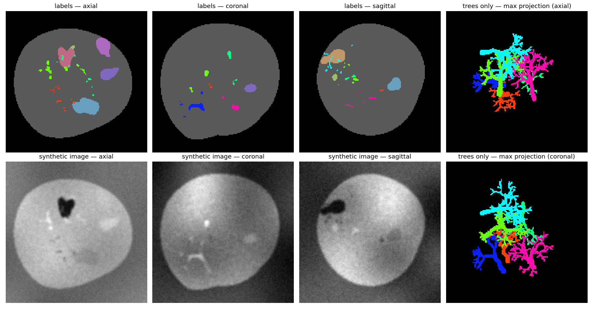
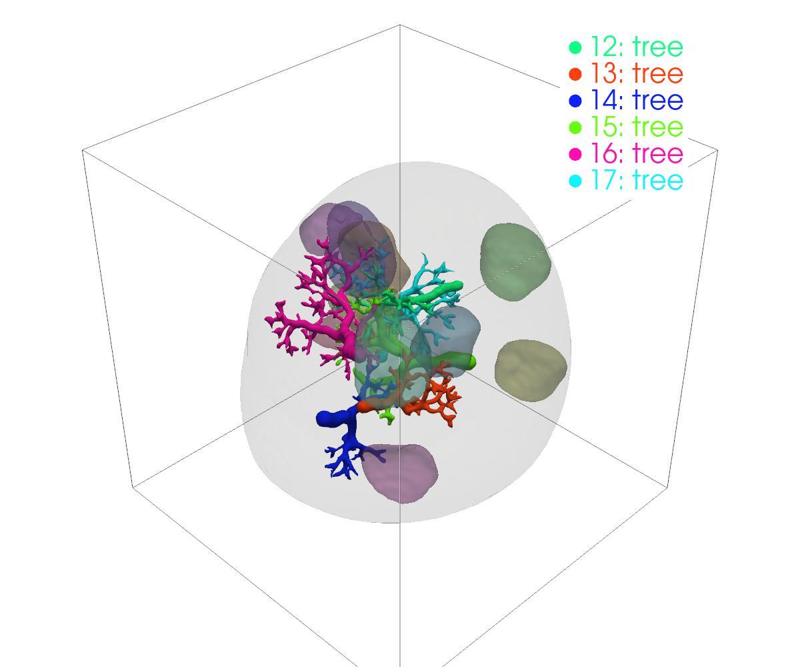

# synth4seg

Procedural 3D training data for segmentation networks. `synth4seg` generates random
label volumes made of **organic blobs** and **branching, vessel-like trees**, then turns each
label map into a **SynthSeg-style synthetic image** (random per-label intensities, blur,
bias field and noise). Because every volume is generated from scratch, you get unlimited,
perfectly labelled training pairs, and the network learns shape rather than any
particular contrast.

The importable Python package is `src` (e.g. `from src.synth_gpu import SynthGenerator`).

| Slices (labels / image / tree projections) | 3D render |
|---|---|
|  |  |

---

## Features

- **Three generators**
  - `gpu` (`src.synth_gpu.SynthGenerator`): batched, on-the-fly, runs on CUDA, Apple MPS
    or CPU. Produces labels and images together. Use this one for training.
  - `smash` (`src.smash`): fast CPU generator. Space is split into blobs by an argmax
    over smooth noise fields, then trees are painted on top.
  - `place` (`src.compose`): slow, careful CPU generator. Blobs and trees are placed
    one at a time inside an enclosing "body", with overlap and connectivity checks.
- **IFS branching trees**: each branch is a contractive affine copy of its parent
  (branch angle, phyllotaxis roll, length scaling). Radii follow Murray's law and branches
  wiggle a little.
- **SynthSeg-style intensities**: Gaussian mixture per label → Gaussian blur → smooth
  multiplicative bias field → additive noise → normalised to [0, 1].
- **Visualisation**: slice montage (PNG), animated slice sweep (GIF) and a 3D surface
  render (PyVista).
- **NIfTI output** (`labels.nii.gz`, `image.nii.gz`), plus `labels.json` with the type and
  voxel count of each label.

---

## Installation

Requires Python ≥ 3.10.

```bash
git clone https://github.com/<your-username>/synth4seg.git
cd synth4seg
python -m venv .venv && source .venv/bin/activate
pip install -r requirements.txt
```

Install PyTorch for your platform (CUDA build, or the default build for macOS/MPS and CPU)
by following <https://pytorch.org/get-started/locally/> if the default wheel is not right for you.
`pyvista` is only needed for the 3D render.

---

## Quick start

```bash
# Default: fast CPU "smash" generator, 160³ volume
python demo.py

# GPU/MPS/CPU batched generator (the one used for training)
python demo.py --method gpu --device mps --out outputs_gpu

# Careful placement generator with an enclosing body
python demo.py --method place --n-blobs 10 --n-trees 6

# Open an interactive 3D window as well
python demo.py --method gpu --show
```

Each run writes to `--out` (default `outputs/`):

| File | Contents |
|---|---|
| `labels.nii.gz` | integer instance label volume (uint16) |
| `image.nii.gz` | synthetic intensity image (float32, [0, 1]) |
| `labels.json` | per-label `type` (`background` / `body` / `blob` / `tree`), `voxels`, and for `smash`/`place`, the shape parameters |
| `slices.png` | axial/coronal/sagittal slices of labels and image, plus max projections of the trees only |
| `sweep.gif` | animated sweep through every slice: image │ labels │ overlay |
| `render3d.png` | 3D surface render: blobs semi-transparent, trees opaque |

### `demo.py` options

| Flag | Default | Applies to | Meaning |
|---|---|---|---|
| `--method` | `smash` | all | `smash`, `place` or `gpu` |
| `--size` | `160` | all | volume edge length (cube) |
| `--seed` | `0` | all | random seed |
| `--out` | `outputs` | all | output directory |
| `--show` | off | all | interactive 3D window |
| `--n-trees` | 8 (smash) / 6 (place, gpu) | all | number of trees |
| `--n-blobs` | `10` | place, gpu | number of blobs |
| `--device` | auto | gpu | `cuda`, `mps` or `cpu` (auto picks cuda → mps → cpu) |
| `--n-classes` | `6` | smash | number of noise fields competing in the argmax |
| `--noise-res` | `4` | smash | low-res noise grid size (smaller = bigger blobs) |
| `--drop` | `0.5` | smash | fraction of blobs sent to background |
| `--no-split` | off | smash | one label per noise class instead of one per connected blob |

---

## Using the generator for training

```python
from src.synth_gpu import SynthGenerator

gen = SynthGenerator(size=160, n_blobs=10, n_trees=6, device="cuda", seed=0)
image, labels, semantic = gen.sample(4)
```

| Tensor | Shape | dtype | Meaning |
|---|---|---|---|
| `image` | `(B, 1, S, S, S)` | float32 | synthetic image in [0, 1] |
| `labels` | `(B, S, S, S)` | int64 | instances: `0` background, `1` body, `2 … n_blobs+1` blobs, `n_blobs+2 … n_blobs+n_trees+1` trees |
| `semantic` | `(B, S, S, S)` | int64 | `0` background, `1` body, `2` blob, `3` tree |

`gen.label_type(k)` returns the type of instance id `k`. `gen.tree_base` equals `n_blobs + 1`.

`train_example.py` documents three ways to feed training:

- **A. One or more GPUs (recommended).** Each process or DDP rank owns a generator on its
  own GPU with its own seed and calls `gen.sample(B)` inside the training loop. No
  DataLoader and no host→device copies.
  ```python
  rank = int(os.environ.get("LOCAL_RANK", 0))
  gen = SynthGenerator(size=160, device=f"cuda:{rank}", seed=1000 + rank)
  for step in range(n_steps):
      image, labels, semantic = gen.sample(batch_size)
      loss = criterion(model(image), semantic)
  ```
  Launch with `torchrun --nproc_per_node=<n_gpus> train.py`.
- **B. GPU + CPU workers.** DataLoader workers only grow the small tree skeletons
  (`TreeSkeletons`), which you pass in with `gen.sample(B, tree_pts=...)`. Rarely worth it,
  because skeletons cost about 2 ms per volume.
- **C. CPU-only nodes.** Each DataLoader worker runs a full CPU generator (`CPUVolumes`).
  To benchmark it, run `python train_example.py <num_workers>`.

---

## How it works

### Blobs

- **`place`** (`blobs.make_blob`): the field `1 − ‖Rᵀ(x − c)/r‖ + roughness·noise(x)` is
  thresholded at 0. The ellipsoid has a uniformly random rotation and the noise is smoothed
  Gaussian noise. Only the largest component is kept, and holes are filled. Blobs may
  overlap by up to 35%. A placement is rejected if it would split an existing structure
  into pieces.
- **`smash`** (`smash.noise_blobs`): `K` low-res Gaussian noise fields are upsampled
  (cubic, then trilinear) and every voxel goes to the field with the largest value there.
  This tiles the whole volume with smooth, irregular regions. Each connected region gets
  its own label, tiny slivers are merged into their neighbour, and a random fraction is
  dropped to background.
- **`gpu`** (`SynthGenerator.blobs`): star-shaped blobs. A voxel is inside when
  `|q| < 1 + roughness·h(q/|q|)`, where `q` is the position in the blob's rotated,
  radius-scaled frame and `h` is a random smooth function of direction (random Fourier
  features). This makes every blob connected and hole-free by construction. Each blob is
  evaluated inside a fixed-size crop, so tensor shapes stay static.

### Trees (IFS)

Each branch is the image of its parent under one of `k ∈ {2, 3}` contractive maps
`wᵢ(x) = sᵢ Rᵢ x + t`:

- `t` moves the origin to the parent's tip.
- `Rᵢ` tilts the branch by 30–50° about an axis perpendicular to the parent. Children are
  spread evenly around the parent, and the pattern rotates by the golden angle at each level.
- `sᵢ ∈ [0.62, 0.8]` shrinks the branch length.

Radii follow Murray's law, `r_parent³ = Σ r_child³`. Branches are drawn as slightly wiggly
polylines and rasterised as tapered capsules (CPU) or splatted as balls (GPU). Trees are
painted last, so they overwrite blobs. In `place`, trees never cross each other. In `smash`
and `gpu`, later trees overwrite earlier ones.

### Intensity synthesis

For each label: mean ~ U(0, 255), std ~ U(0, 25), Gaussian sample → Gaussian blur
(σ ~ U(0.5, 1.5)) → `exp` of a smooth 4³ bias field (σ = 0.3) → additive noise
(σ ~ U(2, 8)) → min–max normalised to [0, 1].

### Notes on device support

`synth_gpu.py` uses only basic tensor ops, because MPS lacks 3D `interpolate`,
`scatter_reduce`, `max_pool3d` and `cummin`. Upsampling is done with separable Catmull–Rom
matrix products, writes go into padded flat buffers with dummy slots (no data-dependent
shapes, no host syncs), and point groups are padded to power-of-two lengths so MPS compiles
only a few graphs.

---

## Repository layout

```
synth4seg/
├── demo.py               # CLI: generate one volume, save NIfTI + visualisations
├── train_example.py      # training integration patterns + CPU-worker benchmark
├── requirements.txt
├── docs/images/          # README preview images
└── src/
    ├── synth_gpu.py      # SynthGenerator: batched CUDA/MPS/CPU generator (labels + image)
    ├── smash.py          # fast noise-argmax blobs + trees (CPU)
    ├── compose.py        # careful body + blobs + trees placement (CPU)
    ├── blobs.py          # noise-perturbed rotated ellipsoid blobs
    ├── trees.py          # IFS tree growth + capsule rasterisation
    ├── intensity.py      # SynthSeg-style image synthesis (CPU)
    └── viz.py            # slice montage, slice-sweep GIF, PyVista 3D render
```

Generated outputs (`outputs*/`) are git-ignored because the NIfTI and GIF files are tens of MB.

---

## Acknowledgements

The intensity model follows the domain-randomisation approach of
[SynthSeg](https://github.com/BBillot/SynthSeg) (Billot et al.).
